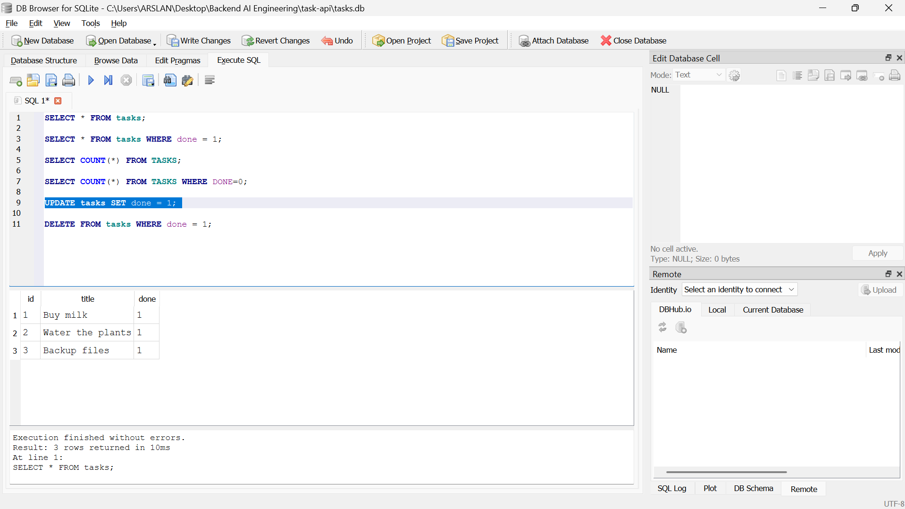
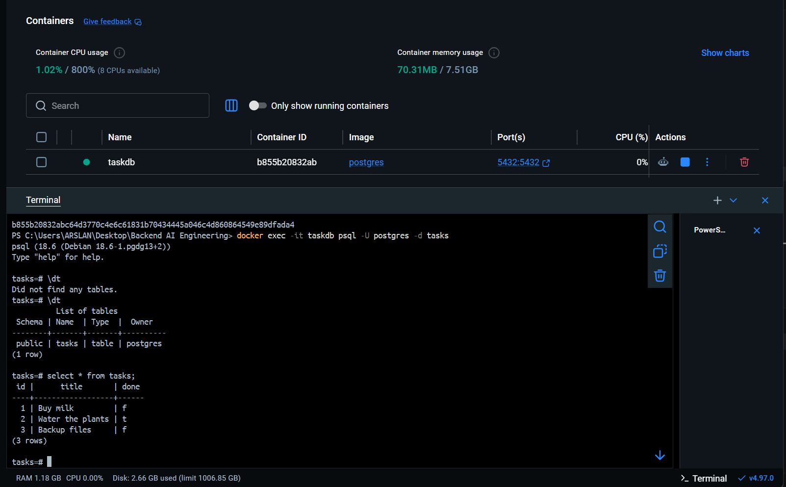

# Task API

A to-do list API built with FastAPI. Supports full CRUD on tasks.

## Tech stack

- Python 3.10+, FastAPI, Uvicorn

## Setup and run

```bash
python -m venv venv
source venv/bin/activate
pip install -r requirements.txt
uvicorn main:app --reload
```

## Table of All Endpoints


| Method | Endpoint                 | Summary         | Description                                                  |
| ------ | ------------------------ | --------------- | ------------------------------------------------------------ |
| GET    | `/`                      | API Info        | Returns the API name, version, and main endpoint.            |
| GET    | `/health`                | Health Check    | Returns the status of the server.                            |
| GET    | `/tasks`                 | List All Tasks  | Returns all tasks from the in-memory list.                   |
| GET    | `/tasks/{id}`            | Get One Task    | Returns a task with the specified ID.                        |
| POST   | `/tasks`                 | Create a Task   | Creates a new task using the JSON request body.              |
| PUT    | `/tasks/{id}`            | Update a Task   | Updates the title and completion status of an existing task. |
| DELETE | `/tasks/{id}`            | Delete a Task   | Deletes the task with the specified ID.                      |
| GET    | `/filter_task?done=true` | Filter Tasks    | Returns tasks filtered by their completion status.           |
| GET    | `/stats`                 | Task Statistics | Returns the total, completed, and pending task counts.       |


## curl -i output


### Command

```bash
curl -i http://localhost:8000/
```

### output

HTTP/1.1 200 OK
date: Sun, 18 Oct 2026 03:46:52 GMT
server: uvicorn
content-length: 58
content-type: application/json

{"name":"Task API","version":"1.0","endpoints":["/tasks"]}

## Swagger UI

Interactive docs are available at [http://localhost:8000/docs](http://localhost:8000/docs).


## A1: AI vs me
### My prompt

Build a full CRUD REST API using Python and FastAPI with an in-memory tasks list containing three initial records (id, title, done) defined at the top of the file. Include GET /, GET /health, GET /tasks, GET /tasks/{id}, POST /tasks, PUT /tasks/{id}, DELETE /tasks/{id}, GET /filter_task?done=true|false, and GET /stats. Use appropriate HTTP status codes (200, 201, 400, 404), validate inputs, handle errors, and provide complete runnable code plus installation, startup, and testing instructions.

### Results


| Check                     | Mine | AI                  |
| ------------------------- | ---- | ------------------- |
| GET /tasks/99 returns 404 | pass | pass                |
| POST {} returns 400       | pass | fail (returned 422) |
| DELETE returns 204        | pass | pass                |


### 1. What did the AI do better?

The AI handled empty request bodies in the POST endpoint better than my code by returning the appropriate status code. It also improved code reusability by creating helper functions to avoid repeating logic.

### 2. What did it get wrong or quietly ignore?

The AI changed FastAPI’s default validation status code from 422 to 400 as requested, but it used a general error message instead of explaining which field was invalid.

### 3. What did my prompt forget to specify?

My prompt did not specify the exact validation rules for task fields, whether PUT should update all fields or allow partial updates, or the format of error message.


## A2: AI vs me
### My prompt
Create a FastAPI Task CRUD API using SQLite. Create the tasks table if it doesn't exist and insert three default tasks only when the table is empty. Implement endpoints to create, read, update, delete, filter tasks by completion status, and get task statistics. Include API information and a health check endpoint. Return 400 for invalid requests and 404 when a task is not found. Use parameterized SQL queries for safety and ensure data persists after restarting the application.

### 1. What did the AI do better?

The AI improved code readability and organized database operations more clearly. However, my original code already used parameterized queries, seeded tasks only when the table was empty, and supported partial updates. The main benefit was cleaner structure, not new functionality.

### 2. What did it get wrong or quietly ignore?

It could change response formats, error messages, or status codes. Dynamically generated SQL also needed careful handling.

### 3. What did my prompt forget to specify?

I did not specify the exact schema, response formats, or update rules. The AI made its own decisions about these details.

## DATABASE
* **Query:** `SELECT COUNT(*) FROM TASKS WHERE DONE = 0;`
* **Result:** This query returned a count of 2, indicating there are currently two incomplete tasks.

### 1. Why SQLite was chosen?

**SQLite** was chosen because It is lightweight database requires zero setup or external server configuration. Key advantages include:
* **single-Filed Storage:** The entire database is contained within a single file on disk, making it highly portable.
* **Persistence:** Unlike in-memory data stores, it fully **survives system restarts** and application crashes without losing data.
* **Serverless Efficiency:** There are no complex background services or database engines to install, configure, or maintain.


## DB Browser screenshot




## Database (PostgreSQL in Docker)

The API runs against a PostgreSQL database in a Docker container.

Start Postgres:

```bash
docker run --name taskdb -e POSTGRES_PASSWORD=dev -e POSTGRES_DB=tasks -p 5432:5432 -v taskdata:/var/lib/postgresql -d postgres
```

| Part | Meaning |
|---|---|
| `--name taskdb` | Name of the container |
| `-e POSTGRES_PASSWORD=dev` | Password for the `postgres` user |
| `-e POSTGRES_DB=tasks` | Creates a database called `tasks` |
| `-p 5432:5432` | Makes the database reachable at `localhost:5432` |
| `-v taskdata:/var/lib/postgresql` | Named volume so data survives container restarts |
| `-d` | Runs in the background (detach mode) |

Check that it is running:

```bash
docker ps
docker exec -it taskdb psql -U postgres -d tasks
```

Inside `psql`, `\dt` lists tables (none yet) and `\q` quits.

## Run with Docker (one command)

This project runs as two containers: the FastAPI app (`api`) and a PostgreSQL database (`db`).

```bash
docker compose up --build
```

The API is then available at http://localhost:8000, with Swagger UI at http://localhost:8000/docs.

To stop everything, run `docker compose down`. Your data is kept in a Docker volume, so it survives a `down` and `up`. To wipe the data as well, run `docker compose down -v`.

## Environment variables

Copy `.env.example` to `.env` before starting. `.env` is git-ignored and must never be committed.

| Variable | Meaning | Example |
|---|---|---|
| `DATABASE_URL` | Connection string to Postgres | `postgresql://postgres:<password>@db:5432/tasks` |
| `POSTGRES_PASSWORD` | Password for the database container | `<choose a password>` |

When you run the app on your own machine (outside Docker), the host in `DATABASE_URL` is `localhost`. Inside docker compose it is `db`, the service name.

## Database

- **Engine:** PostgreSQL, running in the official `postgres` Docker image.
- **Table:** `tasks` (`id serial primary key`, `title text`, `done boolean`). It is created automatically on startup if missing.
- **Seed:** three example tasks are inserted only when the table is empty, so restarting never duplicates them.
- **Persistence:** a named volume (`taskdata`) stores the data outside the container.
- **Queries:** all queries use parameterized placeholders (`%s`), never string-glued SQL.

```bash
docker compose exec db psql -U postgres -d tasks
```

## API reference

| Method | Path | Purpose | Success | Errors |
|---|---|---|---|---|
| GET | `/` | API info | 200 | |
| GET | `/health` | Health check | 200 | |
| GET | `/tasks` | List all tasks | 200 | |
| GET | `/tasks/{id}` | Get one task | 200 | 404 |
| POST | `/tasks` | Create a task | 201 | 400 |
| PUT | `/tasks/{id}` | Update a task | 200 | 400, 404 |
| DELETE | `/tasks/{id}` | Delete a task | 204 | 404 |

Errors are returned as JSON, for example `{"error": "Task not found"}`.

## Example request

```
$ curl -i http://localhost:8000/tasks/1

C:\Users\ARSLAN>curl -i http://localhost:8000/tasks/1
HTTP/1.1 200 OK
date: Wed, 28 Oct 2026 12:21:13 GMT
server: uvicorn
content-length: 40
content-type: application/json
vary: Origin

{"id":1,"title":"Buy milk","done":false}
```

### Data in the database



The screenshot shows `\dt` and `SELECT * FROM tasks;` run inside the container.

