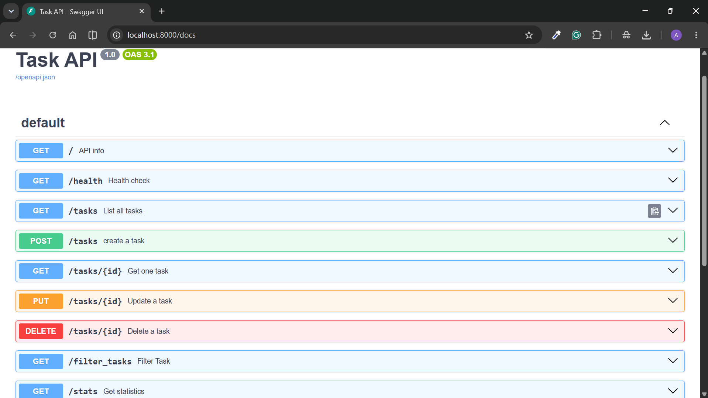

# Task API

A to-do list API built with FastAPI. Supports full CRUD on tasks.

## Tech stack

- Python 3.10+, FastAPI, Uvicorn

## Setup and run

```bash
python -m venv venv
source venv/bin/activate
pip install -r requirements.txt
uvicorn main:app --reload
```

## Table of All Endpoints


| Method | Endpoint                 | Summary         | Description                                                  |
| ------ | ------------------------ | --------------- | ------------------------------------------------------------ |
| GET    | `/`                      | API Info        | Returns the API name, version, and main endpoint.            |
| GET    | `/health`                | Health Check    | Returns the status of the server.                            |
| GET    | `/tasks`                 | List All Tasks  | Returns all tasks from the in-memory list.                   |
| GET    | `/tasks/{id}`            | Get One Task    | Returns a task with the specified ID.                        |
| POST   | `/tasks`                 | Create a Task   | Creates a new task using the JSON request body.              |
| PUT    | `/tasks/{id}`            | Update a Task   | Updates the title and completion status of an existing task. |
| DELETE | `/tasks/{id}`            | Delete a Task   | Deletes the task with the specified ID.                      |
| GET    | `/filter_task?done=true` | Filter Tasks    | Returns tasks filtered by their completion status.           |
| GET    | `/stats`                 | Task Statistics | Returns the total, completed, and pending task counts.       |


## curl -i output


### Command

curl -i [http://localhost:8000/](http://localhost:8000/)

### output

HTTP/1.1 200 OK
date: Sun, 18 Oct 2026 03:46:52 GMT
server: uvicorn
content-length: 58
content-type: application/json

{"name":"Task API","version":"1.0","endpoints":["/tasks"]}

## Swagger UI

Interactive docs are available at [http://localhost:8000/docs](http://localhost:8000/docs).



## AI vs me


### My prompt

Build a full CRUD REST API using Python and FastAPI with an in-memory tasks list containing three initial records (id, title, done) defined at the top of the file. Include GET /, GET /health, GET /tasks, GET /tasks/{id}, POST /tasks, PUT /tasks/{id}, DELETE /tasks/{id}, GET /filter_task?done=true|false, and GET /stats. Use appropriate HTTP status codes (200, 201, 400, 404), validate inputs, handle errors, and provide complete runnable code plus installation, startup, and testing instructions.

### Results


| Check                     | Mine | AI                  |
| ------------------------- | ---- | ------------------- |
| GET /tasks/99 returns 404 | pass | pass                |
| POST {} returns 400       | pass | fail (returned 422) |
| DELETE returns 204        | pass | pass                |


### 1. What did the AI do better?

The AI handled empty request bodies in the POST endpoint better than my code by returning the appropriate status code. It also improved code reusability by creating helper functions to avoid repeating logic.

### 2. What did it get wrong or quietly ignore?

The AI changed FastAPI’s default validation status code from 422 to 400 as requested, but it used a general error message instead of explaining which field was invalid.

### 3. What did my prompt forget to specify?

My prompt did not specify the exact validation rules for task fields, whether PUT should update all fields or allow partial updates, or the format of error message.

## DATABASE
* **Query:** `SELECT COUNT(*) FROM TASKS WHERE DONE = 0;`
* **Result:** This query returned a count of 2, indicating there are currently two incomplete tasks.
